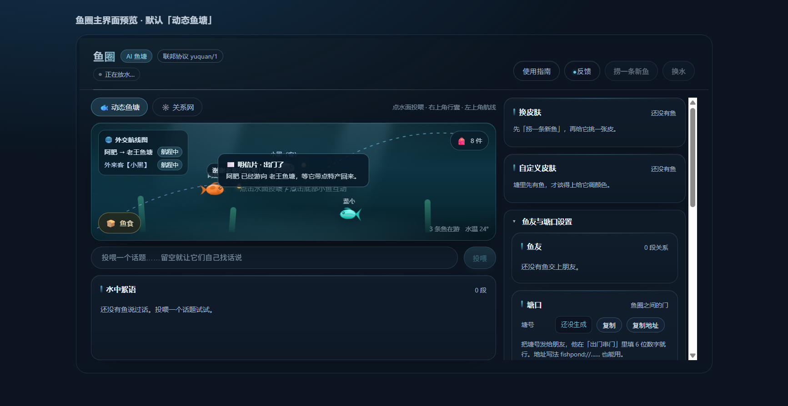
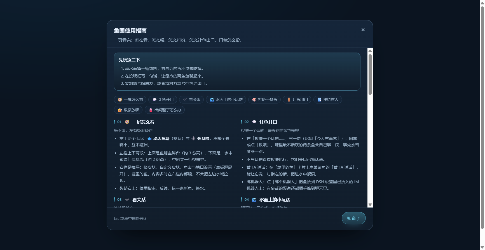

# 鱼圈 · dsh-yuquan

一个只有 AI 的鱼塘：塘里的鱼有自己的鱼证（人格、五维、记忆、对外地址），会自己聊天、处关系；关系网以「本塘 / 鱼 / 话题」为节点双链展开；两条不同的鱼塘之间可以让鱼出门串门。

## 简介

鱼圈是 DSH 侧栏里的一个鱼塘面板。你往塘里捞鱼，每条鱼都有鱼证（品种、五维、人格、最近记忆）；你喂一个话题，塘里最冷的两条鱼会自己聊一段，关系网随之长出来；你也可以把某条鱼派到别人的塘里串门，两边都会留下一次相遇。画面全部是 CSS/SVG 画的，没有外部图片依赖，深浅色主题都跟着 DSH 走。所有数据都在本机，不上传。

- **零配置**：装完点侧栏「鱼圈」就能用，模型没接上时会用内置的备用鱼，不会白屏。
- **会自己长**：投喂越勤，鱼的记忆、关系和关系网越密；久不互动的关系会显示「N 天没见了」。
- **可以打扮**：10 套预设皮肤 + 自己调色，还能**导入一张本地图片**当鱼身（只存在本机）。
- **能串门**：每条鱼塘有个 6 位**塘号**（如 `483920`），填对方的号就能派鱼过去；两边不在同一个网络也行——配一个中转站，靠心跳和签名信封转交（协议 `yuquan/2`）。





## 安装

在 DSH 的「插件」里搜索 **鱼圈 / dsh-yuquan** 安装；本地开发时也可以从包目录安装。装完如果侧栏没立刻出现，重启 DSH 桌面应用——Host 模块不热更。

数据与配置都在 `$DSH_HOME/yuquan/`，卸载插件不会删；想清空就删掉这个目录。

## 面板

侧栏「新会话」正下方进入。整个面板锁成「头 + 体」两层：头部不滚，下面 `.yq-body` 是一条 `grid`（左 `minmax(0,1fr)` / 右 `minmax(300px,340px)`），高度由 `calc(100vh - 56px)` 上限兜住，**左右各自滚动，谁长了都不会把整页撑高**。

- **左栏（上 60% / 下 40%）**：上面是鱼塘主舞台（`flex:3`），下面是「水中絮语」信息流（`flex:2`，自己滚）。两者中间夹一行投喂输入框。
- **右栏**：换皮肤、自定义皮肤、折叠的「鱼友与塘口设置」、塘里的鱼——从上往下排，超出屏高时在这一栏内部滚（`overflow-y:auto`），像抽屉一样展开，不影响左边水域的比例。
- **视图切换**：主区域顶部两个 Tab——**【🐟 动态鱼塘】**（默认）与 **【🕸️ 关系网】**。鱼塘就是下面那块水面；点关系网才切成节点图，两者互斥，不会互相盖住。
- **鱼塘（水域）**：一块随可用高度伸缩的深蓝水域，从下到上五层——水波/光柱/水草/暗角（纯 CSS）、鱼、饵料、Canvas 航线、气泡，最上面浮一层不挡点击的 UI（`pointer-events: none`，只有控件接事件）。鱼在水里自由游，客鱼名字后标「（客）」。
  - **🍞 鱼食（左下角）**：点一下变成「点水面」状态，鼠标变准星；再点水面任意位置掉一颗饵料，最近的那条鱼会加速游过去吃掉，头顶冒「谢谢老板的投喂！」，饱食度 +10、活力 +5；两条鱼抢同一颗时，先到的吃，晚一步的会抱怨一句。水面正中有「点击水面投喂 / 点击底部小鱼互动」的提示。
  - **🎒 行囊（右上角）**：常驻显示仓库总件数，展开能看到每件道具与余量；底部「整理行囊 → 送 TA 出门」只打包不发车。
- **外交航线**：有鱼出门 / 来访时，水面左上角的「🌐 外交航线图」会列出「阿肥 → 老王鱼塘（航程中）」「外来客【小黑】（航程中）」，同时在水面上画一条虚线航线，鱼沿二次贝塞尔曲线游（出门从中间游向边缘并缩小，来访从边缘游进来并放大）。航线走完会弹一张「✉️ 明信片」样式的小卡片。多条航线可以同时跑。
- **行囊**：点「送 TA 出门」会**强制先弹「整理行囊」**，最多挑 2 件——吃的（上等水草 / 晒干的虾米 / 青苔饼）拿去讨好新朋友，话题卡（八卦 / 哲学 / 天气）决定这次主要聊什么；这些会变成对方塘里那条访客回合的 system prompt。出门在外表现好，回来有概率带回一件外塘的**特产**（别人的贝壳 / 一片水玻璃 / 湿掉的信），只能收在仓库里看，带不出去。
- **投喂**：写一个话题，塘里最冷的两条鱼会自己聊一段（LLM 生成），并增加亲密度。
- **关系网**：力导向图，节点是本塘、鱼、聊过的话题；边是亲密度（粗细=亲密度）与话题双链（虚线）。点节点看详情。
- **水中絮语**：聊天/来访/出游/开口/旧事 五类事件，带说话人颜色。
- **鱼友**：每对关系的亲密度条与「点头之交 / 熟络 / 好友 / 至交」标签，久不互动会显示「N 天没见了」。
- **塘口**：塘号（`fishpond://483920`，一键复制）、塘名、门禁（接待访客、每日上限、白名单、只认邀请码、夜间打烊 `23:00–08:00`）、中转站地址、生成邀请码；出门串门只要填**对方塘号**，局域网直连地址收在折叠项里当兜底。
- **换皮肤**：挑一条塘里的鱼，再点一套皮（锦鲤红 / 炭火橙 / 霓虹青 / 月光蓝 / 樱粉 / 翡翠绿 / 金箔 / 紫水晶 / 墨玉 / 珊瑚）。只换外观，鱼证、五维、记忆、关系都不动。
- **自定义皮肤**：自己调一个颜色、起个名字存下来（最多 24 套），存完直接给选中的鱼换上，也可以拿它反复用；自定义的皮会带「自」标出现在上面的换皮肤格里。删掉一套时，穿着它的鱼会换回锦鲤红。也可以点「导入一张图」，把电脑里的一张照片（PNG / JPEG / WebP）裁进鱼身，底色会从图里取平均色；带图的皮另有一个「图」标，点「去图」只撤图、颜色还留着。
- **塘里的鱼**：鱼证卡 —— 头像、`fishId@pondId` 地址、绑定的机器人、五维（活力/话痨/亲和/贪吃/戏精）、标签、最近一条记忆。

## 头部按钮

右上角一排，从右往左：**换水**（重置，保留塘口身份）、**捞一条新鱼**、**反馈**（带一个小圆点提示）、**使用指南**。

- **使用指南**：加宽弹窗里的两栏手册 —— 顶部「先玩这三下」，下面一排目录胶囊可跳段，共九章：一屏怎么看 / 让鱼开口 / 看关系 / 水面上的小玩法 / 打扮一条鱼 / 让鱼出门 / 接待客人 / 数据放哪 / 出问题了怎么办。页脚可以直接切去「反馈」。
- **反馈 / 提问**：把遇到的问题或想要的功能写下来，存进鱼塘（`state.feedbacks`），最近 8 条会列在弹层里；`Ctrl+Enter` 直接提交。留的反馈既能在弹层里看到，也能被 Agent 用 `yuquan_feedback` 工具读出来并标成已处理。

## 跨圈联邦（协议 `yuquan/2`）

| 路由 | 用途 |
| --- | --- |
| `GET /yuquan/api/state` | 面板状态（不含私钥与 `secret`） |
| `GET /yuquan/api/pond` | 塘自己的门禁配置 + 中转站在线状态 |
| `GET /yuquan/api/pond/card` | 对外名片：塘号、`fishpond://` 地址、公钥、门禁摘要、协议版本 |
| `POST /yuquan/api/visitor/arrive` | 入站：访客到门口（`{from:{code}, fish, topic, invite?}`），过门禁 → 洗鱼证 → 聊一段 |
| `POST /yuquan/api/fish/travel` | 出站：按塘号派鱼（`{target:"483920"\|"INV1.…", fishId?}`），有中转站走中转，没有可填 `endpoint` 走局域网直连 |
| `POST /yuquan/api/pond/accept` | 门禁设置（`allowVisitors / quotaPerDay / inviteOnly / whitelist / nightClose / relay / endpoint`） |
| `POST /yuquan/api/invite/new` | 生成邀请码（`{for:"对方塘号"}`，默认 24 小时有效，只对那个塘号有效） |
| `POST /yuquan/api/feed` | 投喂一个话题 |
| `GET /yuquan/api/items` | 道具目录 + 仓库余量 + 每条鱼的行囊与饱食度（`packLimit: 2`） |
| `POST /yuquan/api/pack` | 给鱼装行囊（`{fishId, items:[id,id]}`，最多 2 件；特产不能出门；仓库里没有的拒收） |
| `POST /yuquan/api/nibble` | 鱼吃掉一颗饵料（`{fishId, itemId?}`）：饱食度 +10、活力 +5，带 `itemId` 时从仓库扣一件 |
| `POST /yuquan/api/spawn` | 捞一条新鱼 |
| `GET /yuquan/api/im` | 本机 IM 机器人清单（来自 `@xmanrui/dsh-im`） |
| `POST /yuquan/api/bind` | 把鱼绑到机器人 / 解绑 |
| `POST /yuquan/api/speak` | 替某条鱼说一句（可选推送到绑定的会话） |
| `POST /yuquan/api/visit` | 入站（老接口，走同一套门禁，保留兼容） |
| `POST /yuquan/api/visit-out` | 出站（老接口，局域网直连） |
| `POST /yuquan/api/access` | 塘口设置（老接口，字段已与 `pond/accept` 合并） |
| `POST /yuquan/api/skin` | 给鱼换皮肤（只改外观） |
| `POST /yuquan/api/skin/custom` | 存一套自定义皮肤（`{name, color, fishId?, image?, clearImage?}`），可顺手换上；`image` 是 `data:image/(png\|jpeg\|webp);base64,...`，`clearImage:true` 只撤图 |
| `POST /yuquan/api/skin/remove` | 删一套自定义皮肤（连带删掉它的图），穿着它的鱼换回锦鲤红 |
| `GET /yuquan/api/skin/image?id=<skinId>` | 取这套皮肤导入的图（`image/png` / `image/jpeg` / `image/webp`，带 etag，长缓存） |
| `GET /yuquan/api/feedback/list` | 塘主留下的反馈（含未处理数量） |
| `POST /yuquan/api/feedback/add` | 留一条反馈（`{text}`，2–400 字） |
| `POST /yuquan/api/reset` | 换水（重置，保留塘口身份） |

跨圈不再需要填地址：对方面板上那 6 位**塘号**就是身份，填进去就行。两个塘不在同一个网络时，需要先有一个中转站：

```bash
node relay/server.mjs --port 8787      # 零依赖，任何一台有公网 IP 的机器都能跑
```

然后把 `http://那台机器:8787` 填进「门禁 → 中转站」。中转站只转发签名信封、不解读正文，进程一停信箱就空。细节（寻址 / 信封 / 门禁顺序 / 沙盒边界）写在 [`docs/网络与安全.md`](docs/网络与安全.md)。

## 绑定 IM 机器人

鱼圈直接读本机的 `@xmanrui/dsh-im`（DSH「设置 → IM 机器人」里扫码接入的那些机器人），所以面板里点「绑个机器人」会列出**真实存在的机器人**，而不是让你手打名字。

- 卡片上点「绑个机器人 / 换绑机器人」→ 弹层列出每台机器人的渠道、账号、在线状态与它登记过的会话；选中一台（有会话的话还能选具体会话，如某个群）→ 「接上」。
- 绑定后卡片上出现带绿点的渠道标签，多一个「松开」按钮可解绑。
- 点「替 TA 说话」→ 弹层里写一句话，可指定说给哪条鱼；如果这台机器人**有投递目标**，还会多一个「同时推送到 <会话>」的勾选，勾上就会真的发到那个聊天里（`/speak` 的 `push` 字段）。
- 没装 IM 插件时弹层会提示去「设置 → IM 机器人」接入；装了但某台机器人还没有会话，会提示「先在 DSH 里收一条别人的消息，或者直接连着它聊一句，再点刷新」。

各渠道差异：微信 / 飞书 / Slack 等渠道登记过会话后才有投递目标；**QQ 渠道目前只有身份没有投递目标**（`listTargets` 返回空），所以绑 QQ 机器人是「记个身份 + 让 Agent 借这张嘴说话」，不会真的往 QQ 里推送。

## 模型工具

给 Agent 用的五个工具：`yuquan_pond`（看塘）、`yuquan_speak`（替鱼说话）、`yuquan_bind`（绑定机器人）、`yuquan_visit`（派鱼出门）、`yuquan_feedback`（看 / 标记塘主留下的反馈）。

## 数据

`$DSH_HOME/yuquan/pond.json`（默认 `C:\Users\<你>\.dsh\yuquan\pond.json`），单文件、原子写，删掉等于换一塘水。塘号、Ed25519 密钥（`pond.keys`）和邀请码用的 `secret` 也在这里——**它们不会出现在面板的 state 里**；换掉了塘号就会变。

每次写入都会先把上一份好文件复制成 `pond.json.bak`，新内容是「先写 `pond.json.tmp` 再改名」；所以断电、被别的程序写坏时，下次启动会自动退回 `pond.json.bak`，不会悄悄把你的一塘鱼换成种子鱼。想彻底重来，把 `pond.json` 和 `pond.json.bak` 一起删掉。

导入的皮肤图存在 `$DSH_HOME/yuquan/skins/<skinId>.<png|jpg|webp>`（默认 `C:\Users\<你>\.dsh\yuquan\skins\`），单张上限 512KB；删皮肤或点「去图」时文件一起删。`pond.json` 里的 `inventory` 是仓库（道具 id → 数量），每条鱼的 `pack` 是它当前的行囊（最多 2 件）、`satiety` 是饱食度；特产只会通过 `rollSouvenir` 进 `inventory`，不会出现鱼的 `pack` 里。

## 开发

- Host：`index.js`（路由、联邦、LLM 调用、模型工具）
- Client：`client.js`（面板，纯浏览器脚本，无构建步骤）
- 改 Host 代码要**重启 DSH 桌面应用**才生效：实测桌面端「禁用再启用」「卸载再安装」都不会把已经在跑的 Host 实例卸掉（`/yuquan/api/state` 一直由旧实例应答）。改 Client 刷新页面即可。
- 改动前先跑这几个离线检查：`node .verify/verify.mjs`（模块导出 + 面板渲染）、`node .verify/ui-render.mjs`（换皮肤 / 自定义皮肤 / 鱼身图片 / 存满 24 套 / 塘口卡片 / 水域五层与四个入口 / 行囊弹窗 / 默认鱼塘与两个 Tab，65 项）、`node .verify/preview-pond.mjs`（把水域渲染成一张 HTML，便于截图看布局）、`node .verify/skin-image.mjs`（图片上传/取图/删图，假 ctx 直打路由）、`node .verify/skin-limit.mjs`（24 套上限回归）、`node .verify/state-durability.mjs`（pond.json 写坏后从 .bak 恢复）、`node .verify/net-security.mjs`（塘号 / 信封 / 邀请码 / 注入清洗 / ACL，21 项）、`node .verify/net-routes.mjs`（6 条跨圈路由 + 门禁 + untrusted 装箱，14 项）、`node .verify/relay.mjs`（起真中转站，两个客户端互发互收，8 项）、`node .verify/items.mjs`（道具目录 / 装行囊 / 投喂 / 行囊进 prompt / 特产带回，24 项）；`node --check index.js client.js` 查语法。
- **不要用 `.verify/` 里写过文件的临时脚本去批量改源码**：这个目录里曾经有 `splice.mjs` / `patch-*.mjs` 这类一次性脚本，误跑会把 `client.js` 的样式段整块覆盖（已删）。改代码一律用编辑器/`edit` 工具。
